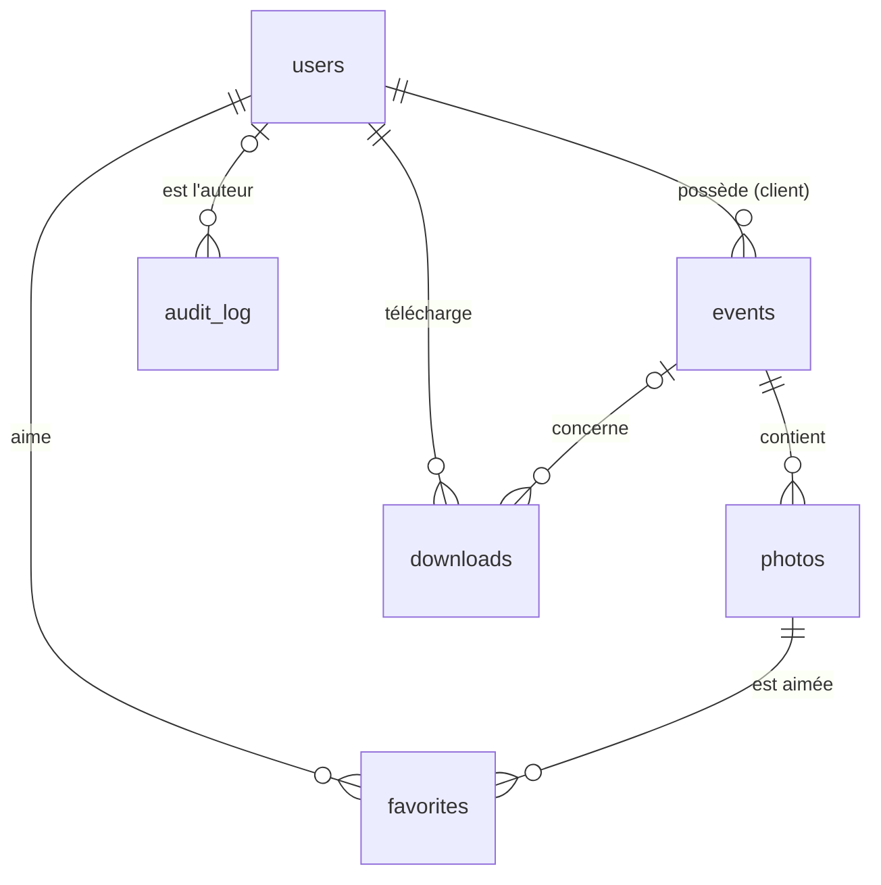

# Base de données KentraPix (MySQL)

MySQL **8.0.16 ou plus** (ou MariaDB 10.6+). Avant 8.0.16, les contrôles `CHECK` sont ignorés.

## 1. Installation pas à pas

### a) Créer la base et un utilisateur dédié (une seule fois, en `root`)

Dans MySQL Workbench (onglet SQL) ou en terminal `mysql -u root -p -P 3307` :

```sql
CREATE DATABASE kentrapix CHARACTER SET utf8mb4 COLLATE utf8mb4_unicode_ci;

-- Un utilisateur réservé à l'application, jamais root.
CREATE USER 'kentrapix'@'localhost' IDENTIFIED BY 'un-mot-de-passe-long-et-unique';
GRANT SELECT, INSERT, UPDATE, DELETE, CREATE, ALTER, INDEX, REFERENCES,
      CREATE VIEW, SHOW VIEW, DROP
  ON kentrapix.* TO 'kentrapix'@'localhost';
FLUSH PRIVILEGES;
```

> `localhost` = l'application tourne sur la même machine que MySQL. Sur un hébergeur,
> utilisez l'hôte qu'il vous donne.

### b) Renseigner `server/.env` (jamais `.env.example`)

```
DB_HOST=127.0.0.1
DB_PORT=3307          # 3306 par défaut ; 3307 si votre MySQL écoute sur ce port
DB_USER=kentrapix
DB_PASSWORD=...
DB_NAME=kentrapix
```

### c) Créer tables et vues

```bash
cd server
npm run db:init
```

Le script affiche la version de MySQL, applique `schema.sql`, les migrations en attente,
puis un tableau de toutes les tables. Il peut être relancé sans risque.

### d) Vérifier

```sql
USE kentrapix;
SHOW TABLES;                                  -- 8 tables + 3 vues
SHOW FULL COLUMNS FROM users;                 -- colonnes avec leur description
SELECT * FROM information_schema.TABLES
 WHERE TABLE_SCHEMA = 'kentrapix';            -- descriptions des tables
```

## 2. Schéma



| Table | Rôle | Lien | Suppression |
|---|---|---|---|
| `users` | Comptes admin et clients | — | — |
| `events` | Galeries livrées à un client | `client_id → users` | **RESTRICT** : on ne peut pas supprimer un client qui a des événements |
| `photos` | Métadonnées des photos (fichiers dans `server/storage/`) | `event_id → events` | **CASCADE** avec l'événement |
| `favorites` | Coups de cœur d'un client | `user_id`, `photo_id` | CASCADE |
| `downloads` | Historique + lien temporaire (10 min) | `user_id`, `event_id` | CASCADE / SET NULL |
| `permissions` | Autorisations globales (page Réglages) | — | — |
| `audit_log` | Journal : qui a fait quoi, quand, quelle IP | `user_id` | SET NULL (le journal reste) |
| `schema_migrations` | Migrations déjà appliquées | — | — |

Chaque colonne a une description (`COMMENT`) visible dans Workbench → clic droit sur la table → *Table Inspector*.

### Règles de conception

- **UUID** (`CHAR(36)`) comme identifiants : impossible de deviner l'adresse d'une photo d'un autre client.
- **utf8mb4** partout : accents, créole, emojis.
- **UTC** pour toutes les dates ; l'affichage en heure locale est fait par le navigateur.
- **Pas d'images dans MySQL** : la base reste légère et rapide ; seuls les chemins sont stockés.
- **Contrôles** : e-mail en minuscules et au bon format, type d'image valide, téléchargement d'au moins une photo.
- **Index** sur toutes les recherches fréquentes (galeries d'un client, photos d'un événement, journal par date).

### Ce que voit un client

Un client voit un événement **uniquement si** `client_id` = son compte **et** `published = 1` **et** `archived = 0`.
Ce filtre est appliqué par le serveur sur chaque requête (API et images).

## 3. Vues prêtes à l'emploi

```sql
SELECT * FROM v_event_stats ORDER BY event_date DESC;   -- par événement : photos, Go, favoris, téléchargements
SELECT * FROM v_client_overview ORDER BY name;          -- par client : galeries, activité, dernière connexion
SELECT * FROM v_storage_usage;                          -- espace disque total
```

## 4. Requêtes utiles

```sql
-- Derniers événements du journal
SELECT a.created_at, u.name, a.action, a.entity, a.details, a.ip
FROM audit_log a LEFT JOIN users u ON u.id = a.user_id
ORDER BY a.id DESC LIMIT 50;

-- Tentatives de connexion échouées des dernières 24 h (détection d'attaque)
SELECT ip, JSON_UNQUOTE(details->'$.email') AS email, COUNT(*) AS essais
FROM audit_log
WHERE action = 'auth.login_failed' AND created_at > NOW() - INTERVAL 1 DAY
GROUP BY ip, email ORDER BY essais DESC;

-- Clients jamais connectés (mot de passe temporaire pas encore changé)
SELECT name, email, created_at FROM users
WHERE role = 'client' AND must_change_password = 1;

-- Photos les plus aimées
SELECT p.filename, e.name AS evenement, COUNT(*) AS favoris
FROM favorites f JOIN photos p ON p.id = f.photo_id JOIN events e ON e.id = p.event_id
GROUP BY p.id ORDER BY favoris DESC LIMIT 20;

-- Purger le journal de plus d'un an
DELETE FROM audit_log WHERE created_at < NOW() - INTERVAL 1 YEAR;
```

> Ne modifiez pas `password_hash` à la main : utilisez « Nouveau mot de passe » dans le studio
> ou `npm run create-admin` pour un admin.

## 5. Sauvegarde et restauration

La base **et** le dossier `server/storage/` vont ensemble : l'un sans l'autre est inutilisable.

```bash
# Sauvegarde (cohérente, sans bloquer le site)
mysqldump -u kentrapix -p -P 3307 --single-transaction --routines --triggers \
  --default-character-set=utf8mb4 kentrapix > kentrapix-2026-10-07.sql

# Restauration
mysql -u kentrapix -p -P 3307 kentrapix < kentrapix-2026-10-07.sql
```

Faites-le **chaque jour** et gardez une copie hors du serveur (disque externe, cloud).

## 6. Faire évoluer la structure

Voir [migrations/README.md](migrations/README.md) : un fichier `NNN_description.sql` par changement,
appliqué automatiquement par `npm run db:init`.
